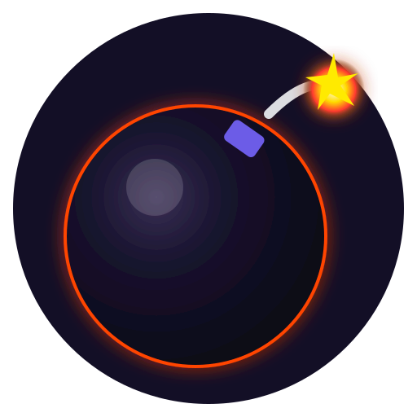

# 💣 Kelime Bombası (Word Bomb)

> **Gerçek zamanlı, çok oyunculu, nefes kesen Türkçe kelime oyunu.**  
> Tamamen web tarayıcısında oynanır. Mobil öncelikli (mobile-only) ve App Store kalitesinde oyun hissi sunar.



---

## 🎯 Oyun Konsepti ve Temel Mekanikler

Oyuncular uzaktan veya yan yana, kendi telefonlarından 4 haneli bir oda koduyla (veya davet linkiyle) aynı odaya katılır.
1. **Sıra ve Bomba**: Sırası gelen oyuncunun elinde bir bomba belirir ve rastgele bir hece/harf grubu verilir (örn: `"KAR"`, `"LAR"`, `"TAN"`).
2. **Kelime Üretimi**: Oyuncu, verilen heceyi **İÇEREN** geçerli bir Türkçe kelime yazmalıdır (örn: *karpuz*, *makarna*, *ankara*).
3. **Fitil ve Gerilim**: Bomba fitili rastgele sürelidir (yaklaşık 8-20 sn). Ne zaman patlayacağı bilinmez!
4. **Bomba Devri**: Doğru kelime yazıldığında bomba hayatta olan bir sonraki oyuncuya geçer ve yeni bir hece verilir.
5. **Patlama ve Can Kaybı**: Fitil tükenmeden kelime yazılamazsa bomba oyuncunun elinde patlar ve 1 can kaybeder.
6. **Eleme ve Şampiyon**: Canı (varsayılan 3) tükenen oyuncu elenir ve izleyici moduna geçer. Son hayatta kalan şampiyon olur! 👑
7. **Tekrarsız Kelimeler**: Aynı oyunda daha önce kullanılmış bir kelime ikinci kez kullanılamaz.
8. **Bonus Can Mekaniği**: Kelimelerde özel harfler (`Z, P, V, J, G, F, H`) kullanılarak harf toplanır; 5 harf tamamlanınca +1 can kazanılır!

---

## ✨ Öne Çıkan Özellikler

### 👑 Lobi ve Otoriter Yönetici (Host) Sistemi
- **Takma Ad & Kimlik**: 2-14 karakter, Türkçe karakter uyumu, küfür/argo filtresi ve odada aynı ismin alınmasını engelleyen denetim.
- **Yönetici Tacı 👑**: Odayı ilk kuran oyuncu otomatik olarak yönetici olur.
- **Tek Dokunuşla Başlatma**: Yönetici en az 2 oyuncu olduğunda dilediği an oyunu başlatabilir (diğerlerinin hazır demesi gerekmez). 1 oyuncuyken buton pasiftir.
- **Canlı Ayarlar**: Yönetici lobide can sayısını (1-5), oyun hızını (Rahat / Normal / Çılgın) ve bonus canı açıp kapatabilir. Ayarlar diğer oyunculara anlık olarak yansır.
- **Oyuncu Atma (Kick)**: Yönetici onay penceresiyle istenmeyen oyuncuları atabilir; atılan oyuncu o odaya tekrar giremez.
- **Yönetici Devri**: Yönetici odadan ayrılırsa yetki odadaki en eski oyuncuya otomatik geçer ve bildirim gösterilir.
- **Tekrar Oyna**: Oyun bitince yönetici tek butonla aynı odadaki oyuncularla yeni oyun başlatabilir.
- **İzleyici & Reconnect**: Oyun sürerken gelenler izleyici olarak katılır. Sırası gelen oyuncu koparsa bomba kilitlenmeden hemen sıradakine geçer ve 15 sn bekleme süresi tanınır.
- **Yüzen Emojiler**: Lobide ve oyun sırasında oyuncular ekrana tek dokunuşla canlı emoji reaksiyonları (🔥, 😂, 💣, 😱, vb.) gönderebilir.

### 📚 111.000+ Kelimelik Zengin Türkçe Sözlük Motoru
- TDK imla kılavuzu ve açık kaynaklı Türkçe kelime listeleri birleştirilmiş, büyük-küçük ünlü uyumuna göre doğal çoğul ekleri (-lar/-ler) türetilerek 111.598 kelimelik yüksek performanslı bellek içi `Set` yapısı oluşturulmuştur.
- **Türkçe Harf Desteği**: `İ/ı`, `I/i`, `ş`, `ğ`, `ç`, `ö`, `ü` karakterleri `toLocaleLowerCase('tr-TR')` ile eksiksiz doğrulanır.
- **Akıllı Hece Havuzu**: Yalnızca sözlükte en az 30-250+ kelimede geçen, doğal ve dengeli Türkçe heceler kullanılır.

### 📱 Saf Mobil UX ve Görsel Tasarım
- **100dvh & Safe-Area**: iOS Safari ve Android Chrome tam ekran uyumu.
- **Visual Viewport API**: Sanal klavye açıldığında kelime giriş alanı klavyenin hemen üzerine oturur, bomba ve oyuncu listesi ekrandan taşmaz.
- **PWA Desteği**: `manifest.json`, tam ekran açılış (`standalone`), tema rengi.
- **Web Audio API**: Dışarıdan dosya indirme gecikmesi olmadan tiktak, gerilim nabzı, bas patlama ve zafer melodileri prosedürel olarak üretilir.
- **Haptik Titreşim**: `navigator.vibrate` ile doğru, yanlış, patlama ve sıra sende geri bildirimleri.
- **Masaüstü Görünümü**: Masaüstünden girilirse telefon mockup'ı ortalanır ve yanda davet QR kodu / link kopyalama alanı sunulur.

---

## 🚀 Kurulum ve Çalıştırma

### Gereksinimler
- Node.js 18+ (Node 20 veya 24 önerilir)
- npm

### 1. Bağımlılıkları Yükleyin
```bash
npm run postinstall
```
*(veya sırasıyla `cd server && npm install && cd ../client && npm install`)*

### 2. Geliştirme (Dev) Modunda Çalıştırma
Aynı anda hem backend hem frontend'i çalıştırmak için:
```bash
npm run dev
```
- **İstemci (Vite):** http://localhost:3000
- **Sunucu (Socket.IO):** http://localhost:3001

### 3. Tek Komutla Canlıya Alma (Production)
Projeyi derleyip tek porttan sunmak için:
```bash
npm run build
npm start
```
Bu komut Vite çıktısını `client/dist` dizinine derler ve Express sunucusu üzerinden `http://localhost:3001` adresinde hem API'yi hem de arayüzü sunar.

---

## 🧪 Entegrasyon Testleri

Sistem için hazırlanmış çok oyunculu simülasyon testini çalıştırmak için:
```bash
node test_game.js
```
Bu test:
1. Türkçe İ/ı ve karakter doğruluğunu,
2. Oda kurma ve yönetici yetkilerini,
3. 1 oyuncuyken başlatma engelini,
4. Aynı isimle katılma engelini,
5. 4 oyuncuyla lobi ve ayar güncellemelerini,
6. 3-2-1 geri sayımını,
7. Hece kontrolü ve kelime kabulünü,
8. Aynı kelimenin tekrar kullanım engelini,
9. Bomba tutan oyuncunun kopması durumunda oyunun kilitlenmeden sıradakine aktarılmasını otomatik doğrular.

---

## 🌐 Canlıya Dağıtım (Deployment)

Proje tek bir Node.js servisi olarak tasarlanmıştır.

### Render / Railway / Fly.io:
- **Build Command:** `npm run postinstall && npm run build`
- **Start Command:** `npm start`
- **Environment Variable:** `PORT=3001` (veya platformun atadığı varsayılan `$PORT`)

### Docker ile Dağıtım (Opsiyonel):
```dockerfile
FROM node:20-alpine
WORKDIR /app
COPY . .
RUN npm run postinstall
RUN npm run build
EXPOSE 3001
CMD ["npm", "start"]
```

---

## 📄 Lisans ve Kaynaklar
- **Sözlük Verileri**: Açık lisanslı TDK tabanlı kaynaklar ([CanNuhlar/Turkce-Kelime-Listesi](https://github.com/CanNuhlar/Turkce-Kelime-Listesi), [mertemin/turkish-word-list](https://github.com/mertemin/turkish-word-list), [emrahcom/turkce_kelimeler](https://github.com/emrahcom/turkce_kelimeler)) derlenerek çoğul ekleri ve morfolojik türetimlerle genişletilmiştir.
- **Yazılım Lisansı**: MIT Lisansı.
